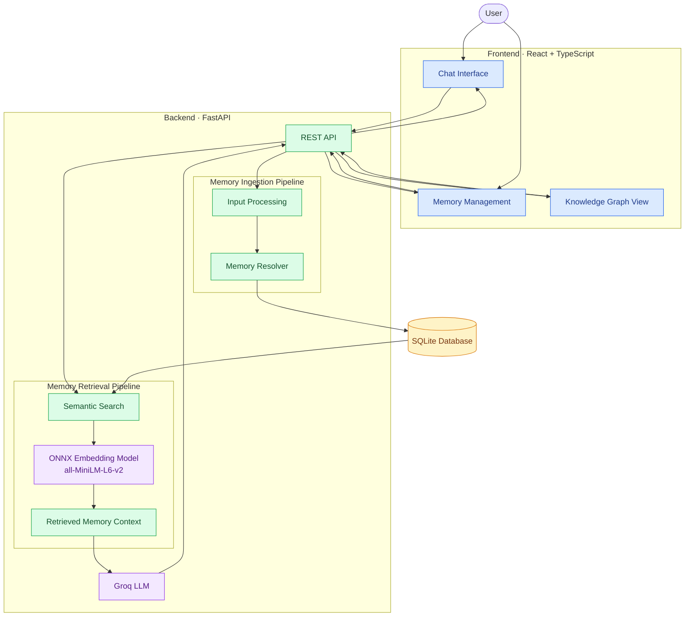

# MemoryMesh

### AI-Powered Persistent Memory System

MemoryMesh is an AI-powered memory system designed to store, retrieve, and manage information through natural-language conversations. It combines semantic search, memory resolution, and language models to maintain useful context over time.

**Live Demo:** [Open MemoryMesh](https://memorymesh-hloe.onrender.com/)

**API Documentation:** [Explore API Docs](https://memorymesh-api-kolz.onrender.com/docs)

**Repository:** [GitHub](https://github.com/csequenc/MemoryMesh)

---

## 🚀 Features

- **Natural Language Memory Ingestion** – Save information through conversational input.
- **Semantic Search** – Retrieve relevant memories using vector embeddings.
- **Memory Resolution** – Identify duplicates, conflicts, and superseded information.
- **Persistent Storage** – Store memories in a structured database.
- **Knowledge Graph** – Visualize entities and relationships between memories.
- **Memory Management** – View, update, and delete stored memories.
- **AI-Powered Responses** – Generate contextual answers using retrieved memories.

## 🛠️ Tech Stack

| Layer | Technology |
|---|---|
| Backend | Python, FastAPI |
| Frontend | React, TypeScript, Vite |
| Database | SQLite, SQLAlchemy |
| Embedding Model | all-MiniLM-L6-v2 |
| Model Runtime | ONNX Runtime |
| LLM Integration | Groq API |
| Deployment | Render |

## 🧠 System Architecture

The architecture separates memory ingestion, memory resolution, storage, and semantic retrieval.



### How It Works

1. **User Input:** Users interact with MemoryMesh through the chat interface.
2. **Memory Ingestion:** The backend processes incoming information and identifies memory candidates.
3. **Memory Resolution:** New candidates are checked against existing memories to identify duplicates, conflicts, and superseded information.
4. **Database Storage:** Resolved memories are stored persistently in SQLite.
5. **Semantic Retrieval:** When a user asks a question, the retrieval pipeline searches for relevant active memories using semantic embeddings.
6. **Context Generation:** Retrieved memories are supplied as context to the language model.
7. **AI Response:** The generated response is returned to the frontend.

## 🏗️ Project Structure

```text
MemoryMesh/
│
├── app/
│   ├── api/
│   ├── database/
│   ├── ingestion/
│   ├── llm/
│   ├── retrieval/
│   └── resolution/
│
├── frontend/
│   └── src/
│
├── dev_tests/
│
├── requirements.txt
├── README.md
└── .gitignore
```

## ⚙️ Installation & Setup

### Prerequisites

- Python
- Node.js and npm
- Groq API key

### 1. Clone the Repository

```bash
git clone https://github.com/csequenc/MemoryMesh.git
cd MemoryMesh
```

### 2. Set Up the Backend

Install dependencies:

```bash
pip install -r requirements.txt
```

Create a `.env` file in the project root:

```env
GROQ_API_KEY=your_groq_api_key
```

Start the backend:

```bash
uvicorn app.api.main:app --reload
```

Backend URL:

```text
http://127.0.0.1:8000
```

Interactive API documentation:

```text
http://127.0.0.1:8000/docs
```

### 3. Set Up the Frontend

Open a new terminal:

```bash
cd frontend
npm install
```

Create a `.env` file inside the `frontend` directory:

```env
VITE_API_BASE_URL=http://127.0.0.1:8000
```

Start the frontend:

```bash
npm run dev
```

Open the local URL provided by Vite.

## 🔍 Semantic Retrieval

MemoryMesh uses the `all-MiniLM-L6-v2` embedding model through ONNX Runtime.

- Generates semantic embeddings for memory retrieval.
- Uses ONNX Runtime for CPU-based inference.
- Loads the model lazily to reduce startup overhead.
- Uses a pinned model revision for reproducibility.

The ONNX implementation avoids the heavier PyTorch-based Sentence Transformers runtime, making deployment more suitable for resource-constrained environments.

## 🗄️ Database Design

MemoryMesh maintains separate databases for personal workflows and the public demo.

| Database | Purpose |
|---|---|
| `memorymesh.db` | Personal and local CLI workflows |
| `memorymesh_demo.db` | Public demo API |

The public API uses the demo database exclusively, keeping public demo activity separate from the personal database.

When the demo database is empty, fictional sample memories are automatically inserted. Existing demo data is not overwritten during subsequent startups.

## 🌐 Live Deployment

The application is deployed on Render.

| Service | URL |
|---|---|
| Frontend | [MemoryMesh Live Demo](https://memorymesh-hloe.onrender.com/) |
| Backend | [MemoryMesh API](https://memorymesh-api-kolz.onrender.com/) |
| API Documentation | [Interactive API Docs](https://memorymesh-api-kolz.onrender.com/docs) |

### Environment Variables

**Backend**

```env
GROQ_API_KEY=your_groq_api_key
FRONTEND_ORIGIN=https://memorymesh-hloe.onrender.com
```

**Frontend**

```env
VITE_API_BASE_URL=https://memorymesh-api-kolz.onrender.com
```

The Groq API key must remain on the backend and must never be exposed in frontend code.

## 🧪 Evaluation

The project includes a scenario-based evaluation suite in `dev_tests/`.

It covers:

- Duplicate detection
- Conflict handling
- Supersession
- Unrelated information
- Unresolved information

The recorded evaluation report contains **21 passing scenarios out of 25**. These are project-defined test scenarios, not an independent benchmark or a fresh evaluation of every deployed version.

## ⚠️ Demo Notes

- The public demo uses one shared database.
- Visitors can create, update, and delete demo memories.
- Changes may be visible to other visitors.
- The demo does not provide individual visitor accounts or isolated sessions.
- Demo data may be reset if the hosting platform replaces or resets its filesystem.
- Do not enter confidential or sensitive information into the public demo.

## 🔮 Future Improvements

Potential areas for further development include:

- Improved retrieval for broad and multi-part queries.
- More comprehensive automated evaluation.
- Enhanced memory visualization.
- Additional memory-management capabilities.

## 👨‍💻 Project

**MemoryMesh** — An exploration of persistent conversational memory, semantic retrieval, and intelligent memory resolution.

---

**Building AI systems that remember.**
