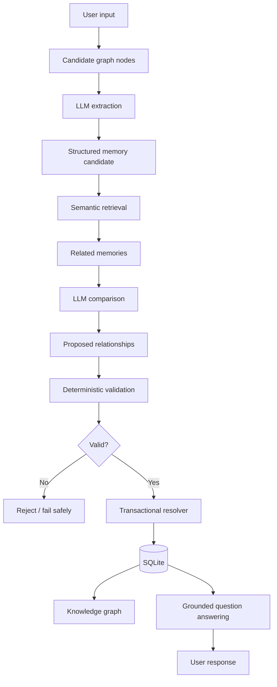

# MemoryMesh

**A conflict-aware memory engine for LLM applications.**

MemoryMesh turns natural language into structured facts, then decides whether each new fact **duplicates, replaces, coexists with, or conflicts with** what is already stored. A language model judges the relationship; deterministic code validates the judgment and applies every database change.

[Live demo](https://memorymesh-hloe.onrender.com/) · [API docs](https://memorymesh-api-kolz.onrender.com/docs) · [Release v1.0.0](https://github.com/csequenc/MemoryMesh/releases/tag/v1.0.0)

## The problem

Most LLM "memory" features append text and retrieve it by similarity.

Tell a system:

> "I live in Delhi."

and later:

> "I moved to Pune."

A basic memory system can leave both statements in storage with no reliable mechanism for determining which one supersedes the other.

MemoryMesh treats memory as **structured state that changes over time**.

Facts are extracted into structured records, related memories are retrieved, an LLM compares the new information against them, and a deterministic resolver validates the proposed relationships before applying the changes. Superseded memories remain in the database so the history of the memory state is preserved.

## Features

- **Structured extraction** — Natural-language input becomes subject / predicate / object records with context and confidence.
- **Conflict-aware resolution** — New facts are classified against related memories as duplicate, supersede, coexist, conflict, or unrelated.
- **Deterministic validation** — The LLM proposes relationships; application code validates every proposed ID and relationship before writing.
- **Subject grounding** — Existing graph nodes are provided to extraction so the model can reuse an existing entity instead of creating near-duplicates.
- **Semantic retrieval** — Sentence embeddings using `all-MiniLM-L6-v2` with ONNX Runtime find related memories on CPU.
- **Knowledge graph** — Entities and relationships are visualized with Cytoscape.js; memories can be inspected, edited, and deleted.
- **Grounded question answering** — Answers are generated from retrieved active memories.
- **Prompt-injection hardening** — Stored memories are passed to the model inside a delimited block and explicitly treated as untrusted data.
- **History preservation** — Superseded memories remain stored instead of being silently overwritten.
- **Evaluation suite** — A dedicated evaluation pipeline tests memory-resolution scenarios across the full system.

## How it works



The important boundary is between **LLM reasoning and persistence**:

```text
LLM
 │
 ├── extracts facts
 └── proposes relationships
          │
          ▼
Deterministic application code
 │
 ├── validates IDs
 ├── validates relationships
 ├── checks database state
 └── applies changes transactionally
          │
          ▼
       SQLite
```

The LLM never directly writes to the database.

## Memory record

| Field | Description |
| --- | --- |
| `memory_id` | Unique memory identifier |
| `subject` | Entity or topic |
| `predicate` | Relationship or attribute |
| `object_value` | Stored value |
| `context` | Context associated with the fact |
| `confidence` | Extraction confidence |
| `source_id` | Origin of the information |
| `status` | Current memory status |
| `valid_from` | Optional validity start |
| `valid_to` | Optional validity end |
| `recorded_at` | Time the memory was recorded |

## Comparison relationships

| Relationship | Meaning |
| --- | --- |
| `DUPLICATE` | The information is already represented |
| `SUPERSEDE` | New information replaces an existing memory |
| `COEXIST` | Both memories can remain valid |
| `CONFLICT` | The information is incompatible or unresolved |
| `UNRELATED` | The memories do not meaningfully relate |

## Memory statuses

| Status | Meaning |
| --- | --- |
| `ACTIVE` | Current accepted memory |
| `SUPERSEDED` | Replaced by newer information |
| `UNRESOLVED` | Contains an unresolved conflict |
| `REJECTED` | Not accepted into the memory store |

## Design decisions

### 1. Understanding, decision-making, and persistence are separate

Language models extract and compare information.

A deterministic resolver validates the proposed relationships and decides the outcome. A controlled database layer applies the changes.

**The LLM never writes directly to the database.**

### 2. The model cannot invent memory keys

Comparison uses temporary IDs for retrieved memories.

The resolver rejects duplicate, missing, or unknown IDs before anything is written, and re-checks them against the database at write time.

Updates and the new memory are committed in one transaction, with rollback on failure.

### 3. History is preserved

Superseded memories stay in the database with a `SUPERSEDED` status.

This means a change such as:

```text
backend → uses_language → Python 3.10
```

followed by:

```text
backend → uses_language → Python 3.12
```

does not erase the original record.

Instead, the resulting state can preserve:

```text
Python 3.10 → SUPERSEDED
Python 3.12 → ACTIVE
```

Deleting a node is the explicit exception: it permanently removes every memory involving that node.

### 4. Stored text is data, not instructions

Memories inserted into prompts are wrapped in a `<memories_data>` block.

Closing-tag sequences inside stored data are neutralized, and prompts explicitly instruct the model to treat the block as untrusted data.

### 5. Grounding before extraction

The extractor receives candidate nodes from the existing graph so it can reuse an existing entity instead of creating near-duplicates such as:

```text
Ishaan
Ishaan M.
Ishaan Maheshwari
```

when they represent the same graph entity.

### 6. Lightweight inference

Embeddings run through ONNX Runtime on CPU using `all-MiniLM-L6-v2`.

The embedding model is loaded lazily and uses a pinned model revision, avoiding the heavier PyTorch-based Sentence Transformers runtime and making the system more suitable for small hosts.

## Evaluation

The project includes a dedicated evaluation pipeline for memory resolution.

The evaluation scenarios cover:

- duplicate detection
- supersession
- conflict handling
- coexistence
- unrelated information
- unresolved information

Run the evaluation with:

```bash
python evaluation.py
```

The evaluation writes:

```text
evaluation_report.json
```

The recorded evaluation contains **25 memory-resolution scenarios**, with the recorded report achieving:

**21 / 25 passed — 84%**

The misses are judgment-sensitive cases involving ambiguous supersession, where the comparison model interprets new information as replacing an existing fact even though replacement is not unambiguously established.

### Interpreting the evaluation

This is a **regression suite**, not an independent benchmark.

The scenarios were written by the project author and are intended to expose weaknesses in the system's semantic reasoning and provide a repeatable way to detect regressions.

They should not be interpreted as evidence that every ambiguous case has one objectively correct answer.

## Live demo

The public demo is a demonstration environment, not a production multi-user service.

- It runs as separate frontend and backend services on Render's free tier.
- The first request after a period of inactivity may take some time while the server wakes up.
- It uses a separate database, `memorymesh_demo.db`.
- The demo database is seeded with fictional sample memories when it starts empty.
- The personal/local database, `memorymesh.db`, is not used by the public API.
- All visitors share the demo database.
- Visitors can create, edit, and delete memories.
- There are no accounts or isolated user sessions.
- Demo data may reset when the server restarts after being idle.
- Messages are processed through an LLM provider.
- Do not enter confidential, private, or sensitive information into the public demo.

## Tech stack

| Layer | Technology |
| --- | --- |
| Backend | Python, FastAPI, Pydantic |
| Database | SQLite, SQLAlchemy |
| Embeddings | `all-MiniLM-L6-v2` via ONNX Runtime |
| LLM | Groq API (`openai/gpt-oss-20b`) |
| Frontend | React, TypeScript, Vite, Cytoscape.js |
| Deployment | Render |

## Project structure

```text
MemoryMesh/
├── app/
│   ├── api/            FastAPI application and routes
│   ├── database/       connection, SQLAlchemy models, repository
│   ├── graph/          knowledge-graph construction
│   ├── ingestion/      extraction and memory pipeline
│   ├── llm/            Groq client
│   ├── models/         Pydantic models
│   ├── query/          answer generation
│   ├── resolution/     LLM comparison, validation, resolver
│   └── retrieval/      embeddings, candidate retrieval, candidate nodes
├── dev_tests/          development tests and evaluation scenarios
├── frontend/           React + TypeScript client
├── evaluation.py
├── evaluation_report.json
├── requirements.txt
└── README.md
```

## Getting started

### Prerequisites

- Python 3.10+
- Node.js
- npm
- Groq API key

Clone the repository:

```bash
git clone https://github.com/csequenc/MemoryMesh.git
cd MemoryMesh
```

### Backend

Create and activate a virtual environment:

```bash
python -m venv venv
.\venv\Scripts\Activate.ps1
```

Install dependencies:

```bash
pip install -r requirements.txt
```

Create a `.env` file in the project root:

```env
GROQ_API_KEY=your_groq_api_key
```

Start the backend:

```bash
uvicorn app.api.main:app --reload
```

The API is served at:

```text
http://127.0.0.1:8000
```

Interactive API documentation is available at:

```text
http://127.0.0.1:8000/docs
```

### Frontend

Open a second terminal:

```bash
cd frontend
npm install
```

Create `frontend/.env`:

```env
VITE_API_BASE_URL=http://127.0.0.1:8000
```

Start the frontend:

```bash
npm run dev
```

## Environment variables

| Variable | Where | Purpose |
| --- | --- | --- |
| `GROQ_API_KEY` | Backend | Groq credentials. Must never be exposed to the frontend. |
| `FRONTEND_ORIGIN` | Backend | Allowed CORS origin in deployment. |
| `LLM_TIMEOUT_SECONDS` | Backend | Optional request timeout. Default: `30`. |
| `VITE_API_BASE_URL` | Frontend | Backend API URL. |

## API overview

| Endpoint | Method | Purpose |
| --- | --- | --- |
| `/api/chat` | POST | Submit a message or explicitly remember information with `/remember` |
| `/api/graph` | GET | Retrieve knowledge-graph data |
| `/api/graph/node` | DELETE | Delete a node and memories involving it |
| `/api/graph/edge` | DELETE | Delete a graph relationship |
| `/api/memories` | GET | Retrieve stored memories |
| `/api/memories/{memory_id}` | PATCH | Update a stored memory |

Ordinary chat messages are treated as questions.

Use `/remember` when explicitly adding information to memory.

## Current limitations

- Semantic retrieval uses a limited top-k candidate set, so relevant memories may occasionally be missed.
- LLM comparison introduces judgment variability.
- The current ingestion flow treats inputs as factual information.
- One input is processed as one intended information unit.
- Relative dates are not normalized into concrete dates.
- Historical question answering over superseded memories is not implemented.
- SQLite is used for local persistence.
- LLM operations require a Groq API key.

## Future improvements

- Evaluate on scenarios written independently of the system's author.
- Compare against simple baselines such as naive overwrite and similarity thresholds.
- Store embeddings instead of recomputing them per request.
- Normalize relative dates and support history-aware questions.
- Improve retrieval for broad and multi-part queries.
- Add stronger production-oriented persistence and isolation for multi-user deployments.

---

**MemoryMesh is an experimental project exploring persistent, conflict-aware AI memory.**
