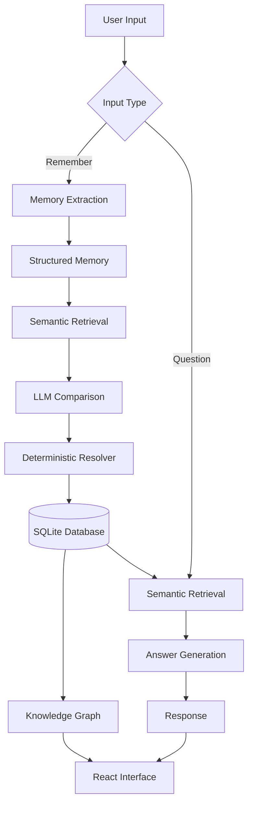

# MemoryMesh

**A general-purpose AI memory engine that extracts, stores, retrieves, and resolves information over time.**

MemoryMesh turns natural-language inputs into structured memories and maintains a persistent knowledge base. When new information arrives, it uses semantic retrieval and LLM-based comparison to identify duplicates, updates, coexistence, and conflicts rather than blindly overwriting existing information.

## Features

- **Structured memory extraction** — converts natural-language input into structured facts.
- **Semantic retrieval** — finds potentially related memories using sentence embeddings.
- **LLM-based comparison** — evaluates relationships between new and existing information.
- **Conflict-aware resolution** — distinguishes duplicates, superseded memories, coexistence, conflicts, and unrelated information.
- **Persistent storage** — stores memories in SQLite using SQLAlchemy.
- **Knowledge graph** — visualizes stored information and relationships.
- **Memory management** — inspect, edit, and delete stored memories.
- **Conversational interface** — ask questions against the current memory database.
- **Evaluation suite** — tests the system against predefined memory-resolution scenarios.

## Architecture



## How memory resolution works

Each memory is represented as a structured record containing:

| Field | Description |
|---|---|
| `memory_id` | Unique memory identifier |
| `subject` | Entity or topic |
| `predicate` | Relationship or attribute |
| `object_value` | Stored value |
| `context` | Context associated with the fact |
| `confidence` | Extraction confidence |
| `source_id` | Origin of the information |
| `status` | Current memory status |
| `valid_from` | Optional validity start |
| `valid_to` | Optional validity end |
| `recorded_at` | Time the memory was recorded |

### Comparison relationships

| Relationship | Meaning |
|---|---|
| `DUPLICATE` | The information is already represented |
| `SUPERSEDE` | New information replaces an existing memory |
| `COEXIST` | Both memories can remain valid |
| `CONFLICT` | The information is incompatible or unresolved |
| `UNRELATED` | The memories do not meaningfully relate |

### Memory statuses

| Status | Meaning |
|---|---|
| `ACTIVE` | Current accepted memory |
| `SUPERSEDED` | Replaced by newer information |
| `UNRESOLVED` | Contains an unresolved conflict |
| `REJECTED` | Not accepted into the memory store |

The comparison model judges semantic relationships. A deterministic resolver validates those judgments and determines database changes. The LLM does not directly modify the database.

Memory history is preserved: superseded memories remain stored rather than being permanently overwritten.

## Technology stack

**Backend**
- Python
- FastAPI
- Pydantic
- SQLAlchemy
- SQLite
- Groq API (`openai/gpt-oss-20b`)
- Sentence Transformers (`all-MiniLM-L6-v2`)

**Frontend**
- React
- TypeScript
- Vite
- Cytoscape.js

## Project structure

```text
MemoryMesh/
├── app/
│   ├── api/
│   ├── database/
│   ├── graph/
│   ├── ingestion/
│   ├── llm/
│   ├── models/
│   ├── query/
│   ├── resolution/
│   ├── retrieval/
│   └── main.py
├── dev_tests/
├── frontend/
├── .gitignore
├── evaluation.py
├── evaluation_report.json
├── inspect_memories.py
├── migrate_context.py
├── requirements.txt
└── README.md
```

## Getting started

### Prerequisites

- Python 3.10+
- Node.js and npm
- A Groq API key

### 1. Clone the repository

```powershell
git clone <repository-url>
cd MemoryMesh
```

### 2. Set up the backend

```powershell
python -m venv venv
.\venv\Scripts\Activate.ps1

pip install -r requirements.txt
```

Create a `.env` file in the project root:

```env
GROQ_API_KEY=your_groq_api_key
```

### 3. Start the backend

```powershell
uvicorn app.api.main:app --reload
```

The backend will be available at:

`http://127.0.0.1:8000`

### 4. Set up the frontend

Open another terminal:

```powershell
cd frontend
npm install
npm run dev
```

Open the local URL printed by Vite.

## API overview

| Endpoint | Method | Purpose |
|---|---|---|
| `/api/chat` | POST | Submit a message or remember information |
| `/api/graph` | GET | Retrieve knowledge graph data |
| `/api/graph/node` | DELETE | Delete a graph node and its associated memory |
| `/api/graph/edge` | DELETE | Delete a graph relationship |
| `/api/memories` | GET | Retrieve stored memories |
| `/api/memories/{memory_id}` | PATCH | Update a stored memory |

The conversational interface supports the `/remember` command for explicitly adding information. Ordinary messages are treated as questions.

## Evaluation

The main evaluation suite contains 25 memory-resolution scenarios.

**Latest recorded evaluation:**

- 21 / 25 passed
- 84% pass rate
- 4 judgment-sensitive classifications involving ambiguous supersession
- 0 evaluation errors

The remaining disagreements concern cases where the comparison model interprets new information as replacing an existing fact even though replacement is not unambiguously established.

The evaluation is intended to expose the limitations of semantic judgment, not to imply that every ambiguous case has one objectively correct interpretation.

## Current limitations

- Semantic retrieval uses a limited top-k candidate set; relevant memories may be missed.
- LLM comparison introduces judgment variability.
- The current ingestion flow treats inputs as factual information.
- One input is processed as one intended information unit.
- Relative dates are not normalized into concrete dates.
- Historical question answering over superseded memories is not implemented.
- SQLite is used for local persistence.
- A Groq API key is required for LLM operations.

## Design philosophy

MemoryMesh separates three responsibilities:

1. **Understanding:** extract and compare information using language models.
2. **Decision-making:** validate proposed relationships and determine resolution outcomes.
3. **Persistence:** apply the resulting changes through a controlled database layer.

The goal is to build a memory system that can evolve its understanding of information without relying entirely on rigid, predefined rules.

---

*MemoryMesh is an experimental project exploring persistent, conflict-aware AI memory.*